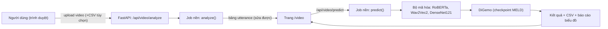
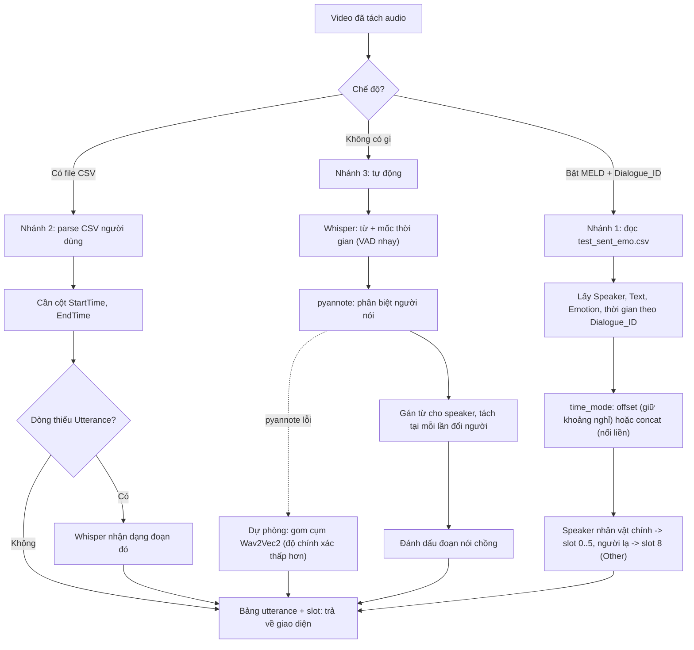
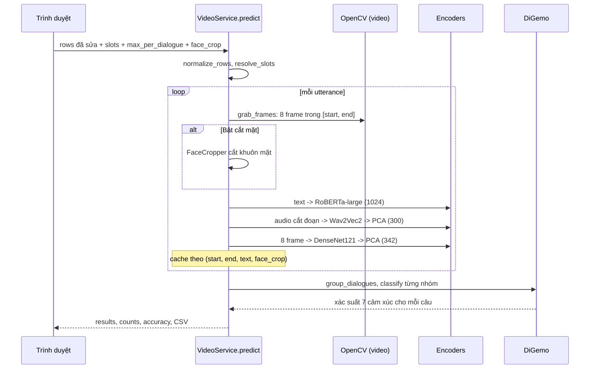
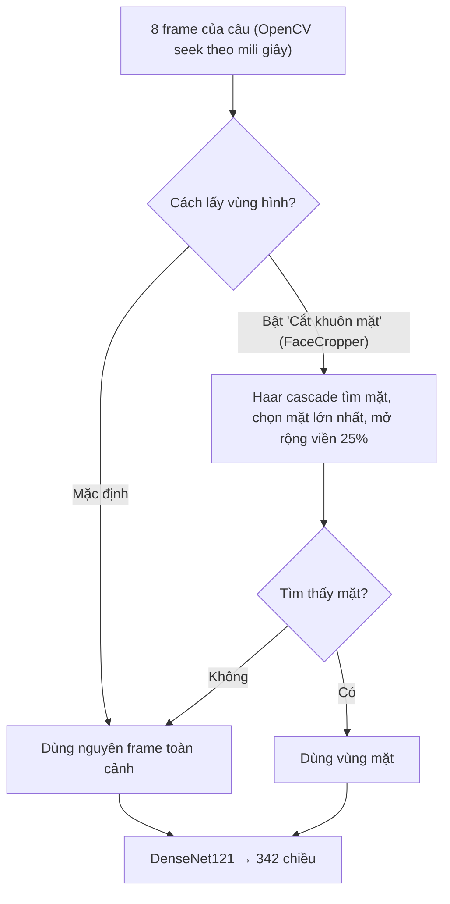
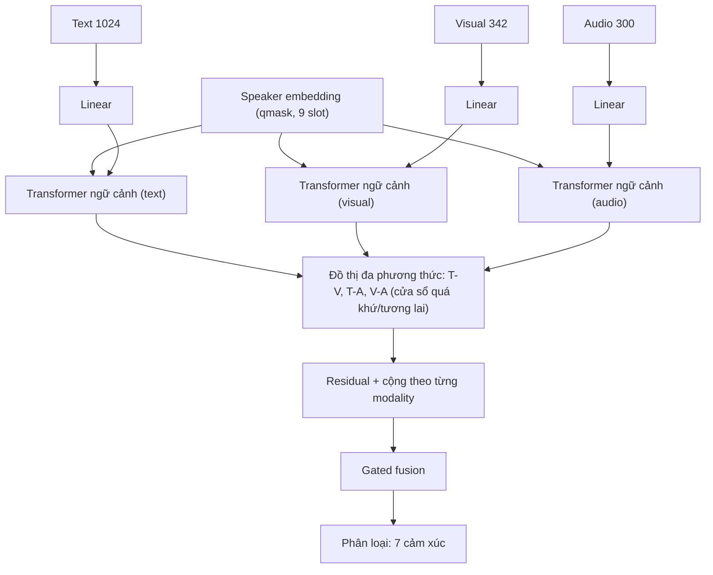
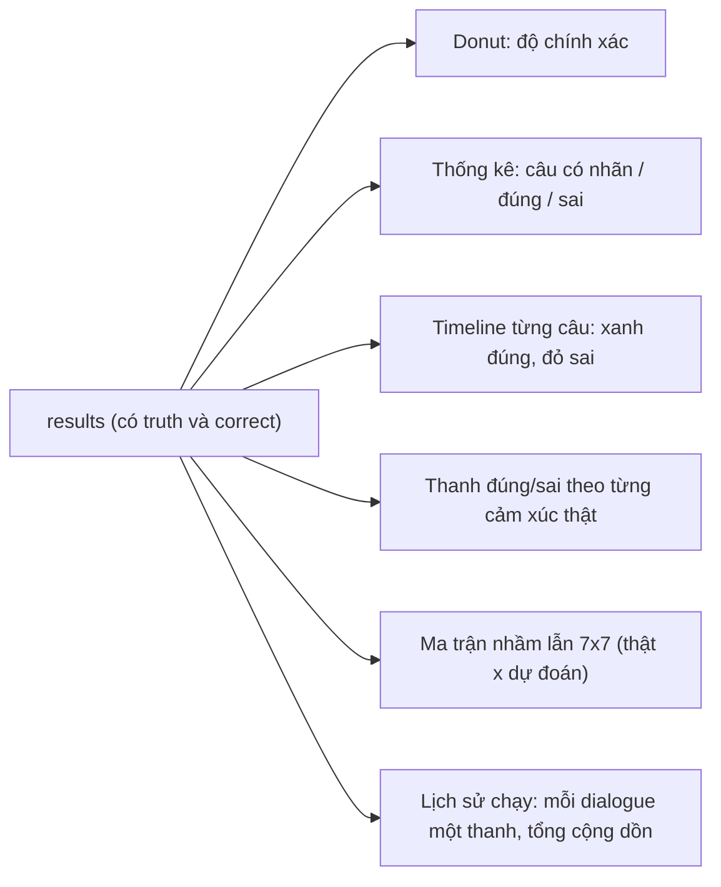

# DiGemo Emotion Studio — Luồng xử lý video upload

Tài liệu mô tả toàn bộ luồng **upload video → tách câu → trích đặc trưng → DiGemo → báo cáo**, gồm các trường hợp: dùng CSV có sẵn, dùng dữ liệu MELD, tự động bằng Whisper + pyannote, cắt khuôn mặt, và biểu đồ kết quả. Nội dung bám theo mã nguồn `app.py`, `video_pipeline.py`, `diarizer.py`, `live_erc.py`, `model.py`, `module.py`, `video.js`.

> Các sơ đồ viết bằng Mermaid. Xem được trực tiếp trong VS Code (extension *Markdown Preview Mermaid Support*), GitHub, hoặc dán vào https://mermaid.live để xuất ảnh đưa vào slide.

---

## 1. Tổng quan kiến trúc

- Hai bước tách rời: **Bước 1 phân đoạn** (ra bảng utterance) và **Bước 2 dự đoán** (ra cảm xúc). Người dùng có thể **sửa bảng** giữa hai bước.
- Tác vụ nặng chạy trong thread nền; trình duyệt hỏi tiến độ qua `/api/video/jobs/{id}` (poll mỗi 0,9 giây).
- Video lưu tạm trên máy, tự xóa sau 2 giờ hoặc khi bấm *Xóa video*.

---

## 2. Bước 1 — Phân đoạn video (`analyze`)

### 2.1 Kiểm tra đầu vào và tách âm thanh

| Kiểm tra | Giá trị |
|---|---|
| Định dạng | mp4, avi, mov, mkv, webm, m4v |
| Dung lượng / độ dài | tối đa 800 MB / 10 phút |
| Số người nói | 1–8 |

Sau đó: `probe_video` (kiểm tra có hình) → `ffmpeg` tách audio **mono 16 kHz** → lưu `audio.npy`.
- **Concat** `(Nối liền các câu)`: đúng với video do merge_meld_video.py tạo, vì các câu được ghép sát nhau, không có khoảng nghỉ. Code cộng dồn thời lượng từng câu để ra mốc bắt đầu và kết thúc.
- **Offset** `(Giữ khoảng nghỉ gốc)`: dành cho một video liền mạch cắt từ tập phim gốc, còn nguyên khoảng nghỉ giữa các câu. Với video gộp của bạn thì tùy chọn này làm mốc thời gian lệch.

### 2.2 Ba nhánh tạo bảng utterance

**Chi tiết nhánh 3 (tự động):**

1. **Whisper** (faster-whisper, tiếng Anh) cho từng từ kèm thời gian bắt đầu/kết thúc.
2. **pyannote** cho hai bản phân đoạn: *exclusive* (mỗi thời điểm một người, dùng để gán từ) và *full* (giữ chỗ nói chồng, chỉ để đánh dấu).
3. Mỗi từ được gán cho speaker có thời gian chồng lấn lớn nhất. Từ nằm xa mọi đoạn có người nói (> 0,5 s) bị bỏ vì thường là Whisper nghe nhầm trong im lặng. Từ lẻ bị kẹp giữa hai từ cùng người khác chỉ được làm mượt khi độ khớp thấp (< 60%), để lời chen ngang ngắn như "no!" vẫn giữ đúng người.
4. Chuỗi từ được cắt tại mỗi lần đổi người, rồi chia thành câu theo khoảng nghỉ (0,8 s), dấu câu, tối đa 14 giây hoặc 30 từ.
5. Mỗi câu có tỉ lệ `overlap` (0–1) từ phân đoạn *full*.

### 2.3 Các trường hợp cần người kiểm tra

Máy chỉ ước đoán ranh giới câu và người nói, nên chỉ **đánh dấu ⚠ kèm lý do**, người dùng quyết định (module `asd_faces.flag_for_review`):

| Mã cảnh báo | Ý nghĩa |
|---|---|
| `overlap` | Có người nói chồng |
| `maybe_split` | Cùng người, nghỉ ngắn, câu trước chưa kết thúc: có thể là một câu bị ngắt |
| `fast_turn` / `cut_off` | Đổi người quá nhanh / câu chưa xong đã bị người khác nói |
| `short` / `long` | Câu quá ngắn hoặc quá dài |
| `no_face`, `face_fallback`, `face_mismatch`, `shared_face` | Bằng chứng khuôn mặt thiếu hoặc mâu thuẫn (chỉ khi dùng NVIDIA ASD) |

Các ngưỡng nằm trong `ReviewConfig`, chỉ mang tính gợi ý, không phải quy tắc đúng/sai.

---

## 3. Bảng utterance, người dùng chỉnh sửa

Giao diện cho phép: sửa Speaker / thời gian / transcript, phát lại đúng đoạn video, thêm/xóa dòng, gán **Speaker → slot** (0–7 là nhân vật MELD, 8 là Other), tải CSV đầu vào. Ở chế độ MELD, bảng thêm cột **nhãn CSV** để so sánh với dự đoán.

---

## 4. Bước 2 — Dự đoán (`predict`)

### 4.1 Ba loại đặc trưng

| Phương thức | Nguồn | Mô hình | Kích thước |
|---|---|---|---|
| Text | transcript câu | RoBERTa-large đã fine-tune MELD (token `[CLS]`) | 1024 |
| Audio | đoạn audio của câu (tối đa 15 s) | Wav2Vec2-base, lấy trung bình theo thời gian, rồi Scaler + PCA | 300 |
| Visual | 8 frame đều nhau trong câu | DenseNet121 (ImageNet), trung bình 8 frame, rồi Scaler + PCA | 342 |

Các bộ Scaler/PCA (`online_*_transform.joblib`) phải **cùng pipeline với checkpoint**; không thay tùy ý.

### 4.2 Trường hợp cắt khuôn mặt

- **Mặc định** là frame toàn cảnh, giống cách tạo đặc trưng lúc huấn luyện, nên khớp checkpoint nhất.
- **Haar (có sẵn)** nhẹ nhưng chỉ chọn mặt lớn nhất, nên khi nhiều người cùng khung hình có thể chọn nhầm người. Giao diện ghi rõ đây là thử nghiệm và *khác lúc training*.

### 4.3 Mô hình DiGemo

Mỗi hội thoại được đưa vào **toàn bộ một lần** (`umask`, `qmask` mô tả người nói theo slot); nếu hội thoại dài hơn `max_per_dialogue` thì chia thành các nhóm cân bằng (`group_dialogues`). Đầu ra là softmax 7 nhãn: neutral, surprise, fear, sadness, joy, disgust, anger.

---

## 5. Kết quả và biểu đồ

### 5.1 Dữ liệu trả về và CSV

CSV kết quả (`results_csv`) có các cột:

`Dialogue_ID, Utterance_ID, Speaker, Utterance, StartTime, EndTime, Emotion (nhãn thật nếu có), Predicted, Confidence, prob_neutral … prob_anger`

CSV này dùng thẳng để vẽ biểu đồ ngoài ứng dụng (Excel, Python, v.v.). CSV đầu vào (`utterances_input.csv`) có cùng định dạng với metadata lúc huấn luyện: `Dialogue_ID, Utterance_ID, Speaker, Utterance, StartTime, EndTime, Emotion`.

### 5.2 Báo cáo trong ứng dụng (khi có nhãn, chế độ MELD)

- Lịch sử chạy được lưu ở `localStorage` của trình duyệt (tối đa 40 dialogue gần nhất, mỗi dialogue giữ lần chạy mới nhất).
- Độ chính xác chỉ tính trên các câu **có nhãn**, nên không so sánh trực tiếp với con số F1 của bài báo.

---

## 6. Giới hạn cần nêu rõ khi trình bày

1. Checkpoint huấn luyện trên **MELD (tiếng Anh)**; chưa kiểm chứng với tiếng Việt hay dữ liệu đời thực.
2. Thứ tự slot nhân vật MELD (`chandler→0 … rachel→4, ross→5`) là **giả định**; nếu lúc train dùng thứ tự khác thì phải sửa.
3. Tách câu, gán người nói, và gán khuôn mặt đều là **ước đoán của máy**, nên có cơ chế cảnh báo ⚠ để người xác minh lại.
4. Cắt mặt (Haar hoặc ASD) khác với cách trích đặc trưng lúc huấn luyện, nên có thể làm lệch kết quả; cần so sánh có/không cắt mặt trên cùng video.
5. Nhãn và độ tin cậy là đầu ra của mô hình, không phải chẩn đoán tâm lý.
